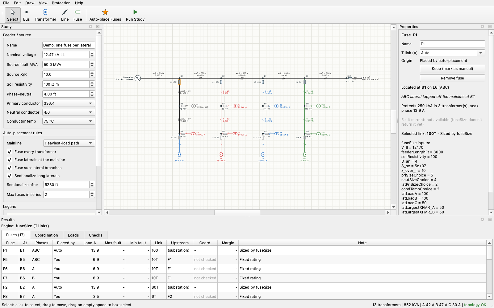

# dist-fuse-calculator

A design-assist tool for overcurrent fuses on radial medium-voltage distribution feeders: ECE 6320 term project by Gabriel Chamon and Micheal Elrod-Mocek.

You draw the feeder as a one-line diagram. The tool proposes fuse locations, works out the single-line-to-ground fault current at each fuse, and sizes every EEI-NEMA **T link** from the bottom of each branch up so each fuse coordinates with the one below it. Results show on the diagram.



> **Status:** every fuse is sized, including fuses below other fuses, and the SLG fault current at each fuse is shown. Transformer cutouts are sized by the 125% rule unless you fix a rating. `fuseSize` coordinates each fuse with its largest child internally but doesn't return the table limit, so coordination pass/fail and margin aren't shown yet. Three-phase and minimum fault currents aren't computed.

## Quick start

Requires Python 3.10+.

```bash
git clone https://github.com/MichealElrodMocek/dist-fuse-calculator.git
cd dist-fuse-calculator
python3 -m venv .venv
source .venv/bin/activate        # Windows: .venv\Scripts\Activate.ps1
pip install -r requirements.txt  # PySide6, numpy, pytest, and this repo in editable mode

fusecalc                                              # empty feeder
fusecalc examples/demo_first_fuse_per_lateral.json    # the demo
pytest                                                # tests
```

## Demo

**File → Open Example → Demo First Fuse Per Lateral** opens a 12.47 kV feeder with a 336.4 mainline and four laterals (one three-phase, one each on A, B and C), each with a single fuse at the tap. Each transformer has a cutout whose rating is fixed in the file; **Autosize Fuses** clears those and re-derives the same ratings with the 125% rule.

The lateral fuses F1–F4 come out 30T, 30T, 30T and 20T as the fault current falls from 2.06 kA to 1.31 kA with distance from the substation. Select a fuse to see the exact solver calls it was sized with. Change an input in the Study panel (for example, Source fault MVA 50 → 75) and the study re-runs. Put a fuse partway down a lateral (Fuse tool, `F`) and both it and the tap fuse above it are re-sized.

The other three examples (**Long Weak Tap**, **Short Stiff Feeder**, **Heavily Branched**) have no fuses saved; run **Auto-place Fuses** on them, then **Autosize Fuses**, to get every cutout, lateral and sub-lateral fuse sized.

## How a study runs

`fusecalc/engine/fuse_sizing.py` holds the solver: three functions, called as a black box.

```python
feederTapCurrent(V_ll, feederLengthFt, soilResistivity, D_an, S_sc, x_over_r,
                 priSizeChoice, priTypeChoice, neutSizeChoice, neutTypeChoice,
                 latPriSizeChoice, latPriTypeChoice, condTempChoice,
                 returnPhasor=False)                      ->  SLG fault current (A)
latFuseCurrent(V_ll, I_f_previous, x_over_r, latLengthFt,
               latPriSizeChoice, latPriTypeChoice, latNeutSizeChoice, latNeutTypeChoice,
               soilResistivity, condTempChoice, D_an,
               returnPhasor=False)                        ->  SLG fault current (A)
fuseSize(V_ll, I_LG_mag, downstreamPriSizeChoice,
         latLoadA, latLoadB, latLoadC,
         latLargestXFMR_A, latLargestXFMR_B, latLargestXFMR_C,
         largestChildNonTX)                               ->  T link rating
xfmrFuseSize(V_ll, latLargestXFMR_A, latLargestXFMR_B, latLargestXFMR_C)
                                                          ->  T link rating (cutout)
```

The adapter (`fusecalc/engine/adapter.py`) makes two passes, recording each call's arguments with exactly those names:

1. **Fault current, top-down.** The first fuse of a branch gets `feederTapCurrent` at its drawn distance from the source, with the Study panel's primary conductor for that whole run. A fuse below another fuse gets `latFuseCurrent` chained from the fuse above, one call per drawn segment with that segment's conductor. Calls pass the complex fault current along (`returnPhasor=True`), so chaining is exact.
2. **Sizing, bottom-up.** `fuseSize` sizes each fuse from the fault current there, the load and largest transformer below it, and the largest fuse directly below it that isn't a transformer cutout (`largestChildNonTX`). Children are sized before parents. Transformer cutouts get `xfmrFuseSize`, the same 125% rule `fuseSize` applies to the largest transformer below a fuse.

| Argument | Taken from |
|---|---|
| `V_ll`, `S_sc`, `x_over_r` | Study panel: nominal voltage (kV → V), source fault MVA (→ VA), source X/R |
| `soilResistivity`, `D_an`, `condTempChoice` | Study panel: soil resistivity, phase–neutral spacing, conductor temperature |
| `priSizeChoice`/`priTypeChoice` | Study panel: primary conductor and material |
| `neutSizeChoice`/`neutTypeChoice`, `latNeut*Choice` | Study panel: neutral conductor and material (feeder and laterals) |
| `latPriSizeChoice`/`latPriTypeChoice`, `downstreamPriSizeChoice` | Conductor and material of the segment |
| `feederLengthFt` / `latLengthFt` | Drawn distance from the source to the fuse / length of each segment |
| `I_f_previous`, `I_LG_mag` | Fault current at the fuse above / at this fuse |
| `latLoadA/B/C` | Connected kVA per phase downstream of the fuse |
| `latLargestXFMR_A/B/C` | Largest transformer kVA per phase downstream of the fuse |
| `largestChildNonTX` | Largest rating of the fuses directly below that aren't transformer cutouts |

The conductor sizes and materials in `fusecalc/data/conductors.json` and the temperatures in `fusecalc/model.py` must stay in the same order as `condSize`, `condType` and `condTempVec` in the solver. `tests/test_engine.py` fails if they or the signatures drift. Edit the solver in place at `fusecalc/engine/fuse_sizing.py`; a new upload to the repo root won't be picked up.

## Using the editor

| Tool | Key | What it does |
|---|---|---|
| Select | `V` / `Esc` | Select, drag to move, box-select; `Delete` removes |
| Bus | `B` | Place a junction; wires to the selected node |
| Transformer | `T` | Place a transformer on the selected bus's least-loaded phase |
| Line | `L` | Click node to node; click empty space to drop a bus and keep going |
| Fuse | `F` | Click a line to toggle a fuse at its upstream end |

- **Study** (left) holds the `fuseSize` inputs and the auto-placement rules. **Properties** (right) edits the selection and shows its load and sizing. **Results** (bottom) has the Fuses, Coordination, Loads and Checks tabs.
- **Auto-place Fuses** (`Ctrl+Shift+A`) proposes, in priority order: transformer cutouts, lateral taps, sub-lateral branches, and sectionalizing fuses on long laterals, capped at *N* fuses in series. Hand-placed or edited fuses are kept.
- **Autosize Fuses** (`Ctrl+Shift+F`) sets every fuse back to *Auto* and sizes them all, then reports how many were sized and how many need attention. `Ctrl+Z` restores any ratings you had typed in.
- **Run Study** (`F5`) re-runs sizing and fault currents but keeps ratings you typed in (a typed rating fixes that fuse; the fuses above still coordinate with it). It also runs after every edit unless you turn that off in the Protection menu.
- Lines are drawn one-line style: weight, color and tick marks show the phases (ABC heavy black, A red, B blue, C green). The Checks tab flags phase and topology errors.
- Feeders save as plain JSON. Unknown keys are ignored on load.

## Project layout

```
fusecalc/
  model.py         Feeder data model, JSON save/load (no Qt)
  topology.py      Radial tree, validation, per-phase load roll-up
  placement.py     Rule-based fuse placement
  library.py       Conductor list (data/conductors.json), in fuseSize's index order
  engine/
    fuse_sizing.py Solver: feederTapCurrent, latFuseCurrent, fuseSize
    api.py         Solver input records and result types: the GUI ↔ solver contract
    adapter.py     Builds the solver inputs from the drawing and runs both passes
  gui/             PySide6 editor (the only package that imports Qt)
examples/          Demo feeder plus three validation feeders
tests/             Solver, solver contract and adapter tests
```

## Open items

Fixed in the 11.21 solver integration (`fuse_sizing.py`):

- [x] 477 and 556.5 conductors crashed (`gmr_feet` aliasing): fixed by Gabriel's per-material tables.
- [x] SLG fault was 3× high: `I_012` is now `V_ph / Z_sum`. A bolted SLG at the substation now equals the three-phase fault, as it should with Z0 = Z1 there.
- [x] `latFuseCurrent` assumed the upstream impedance had the source X/R, so chained results drifted (+10% over one hop, +32% over ten). It now takes the complex current from `returnPhasor=True` and recovers the exact upstream impedance; a plain magnitude still works the old way.
- [x] `fuseSize` crashed (`UnboundLocalError`) for a 140T/200T child or a transformer above ~575 kVA per phase, and for a transformer needing more than 200T. These now default to 200T, with a warning in the last case.
- [x] `fuseSize` read the module-level `latPriSizeChoice` for the ampacity check and indexed `maxFuseForLat` by material. Both now use the `downstreamPriSizeChoice` argument (renamed from `downstreamPriTypeChoice`).
- [x] `largestChildNonTX` was ignored unless it matched a T size exactly; it now rounds up to the next T size.

- [x] Transformer cutouts were never sized (`fuseSize` only returns the fuse above). Added `xfmrFuseSize`: fuseSize's own 125% rule as a separate function, so cutouts placed by auto-place get a rating.

Still open:

- [ ] A child needing 200T gets a 200T parent with no warning, although the two can't coordinate.
- [ ] Return the coordination table limit from `fuseSize`, so the GUI can show pass/fail and margin
- [ ] Three-phase and minimum fault currents
- [ ] Per-segment neutral conductor (laterals use the Study panel neutral today)
- [ ] Phase-balancing suggestions (the Loads tab already shows per-phase current and imbalance)
- [ ] Validation write-up on the example feeders
