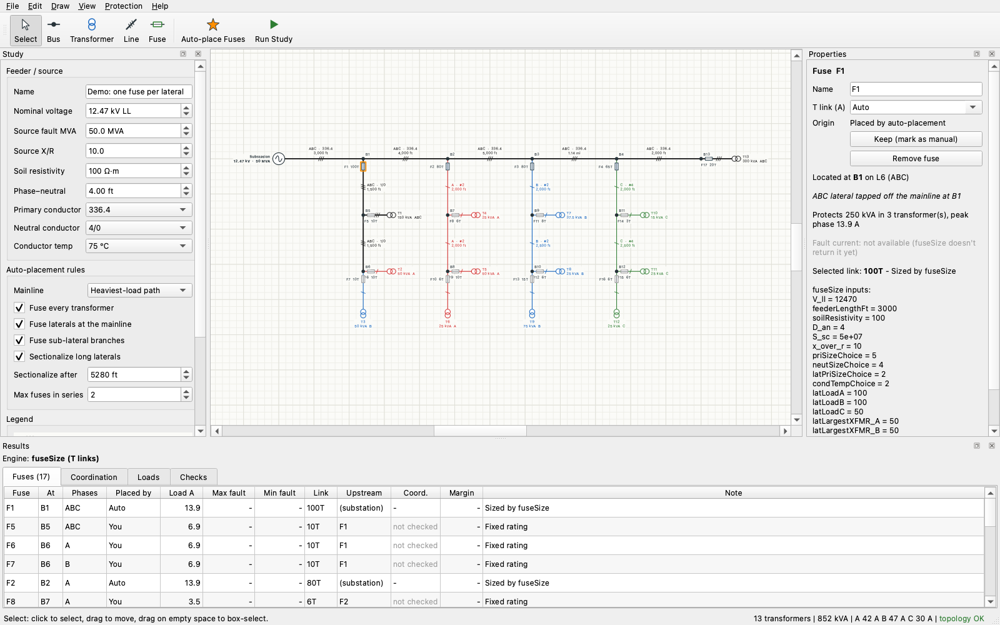

# dist-fuse-calculator

A design-assist tool for overcurrent fuses on radial medium-voltage distribution feeders: ECE 6320 term project by Gabriel Chamon and Micheal Elrod-Mocek.

You draw the feeder as a one-line diagram. The tool proposes fuse locations and sizes the EEI-NEMA **T link** for the first fuse of each branch with the `fuseSize` solver, then shows the result on the diagram.



> **Status:** `fuseSize` sizes the first fuse of each branch (the lateral tap fuse). Fuses below another fuse aren't sized yet; that needs recursive branch solving. Transformer cutouts take a fixed rating. `fuseSize` works out fault current and coordination internally but doesn't return them yet, so the GUI shows those as *not available*.

## Quick start

Requires Python 3.10+.

```bash
git clone https://github.com/MichealElrodMocek/dist-fuse-calculator.git
cd dist-fuse-calculator
python3 -m venv .venv
source .venv/bin/activate        # Windows: .venv\Scripts\Activate.ps1
pip install -r requirements.txt  # PySide6, numpy, pytest, and this repo in editable mode

fusecalc                                              # empty feeder
fusecalc examples/demo_first_fuse_per_lateral.json    # the demo
pytest                                                # tests
```

## Demo

**File → Open Example → Demo First Fuse Per Lateral** opens a 12.47 kV feeder built for what `fuseSize` handles today. It has a 336.4 mainline and four laterals (one three-phase, one each on A, B and C), each with a single fuse at the tap. Each transformer has a cutout whose rating is fixed in the file using `fuseSize`'s 125% rule. Nothing sits below a lateral fuse except those cutouts, so no recursive solving is needed.

`fuseSize` sizes the lateral fuses F1–F4 as 100T, 80T, 80T and 65T, getting smaller with distance from the substation. Select a fuse to see the exact `fuseSize` arguments it was sized with. Change an input in the Study panel (for example, Source fault MVA 50 → 75) and the study re-runs.

## How a study runs

`fusecalc/engine/fuse_sizing.py` holds the solver, called unchanged:

```python
fuseSize(V_ll, feederLengthFt, soilResistivity, D_an, S_sc, x_over_r,
         priSizeChoice, neutSizeChoice, latPriSizeChoice, condTempChoice,
         latLoadA, latLoadB, latLoadC,
         latLargestXFMR_A, latLargestXFMR_B, latLargestXFMR_C)  ->  T link rating
```

For each fuse with no fuse upstream of it, the adapter (`fusecalc/engine/adapter.py`) fills a `FuseSizeInputs` record with exactly those names from the drawing, calls `fuseSize`, and reports its warnings as the fuse's note:

| Argument | Taken from |
|---|---|
| `V_ll`, `S_sc`, `x_over_r` | Study panel: nominal voltage (kV → V), source fault MVA (→ VA), source X/R |
| `soilResistivity`, `D_an` | Study panel: soil resistivity, phase–neutral spacing |
| `priSizeChoice`, `neutSizeChoice`, `condTempChoice` | Study panel: primary conductor, neutral conductor, conductor temperature, sent as indices into `fuseSize`'s tables |
| `latPriSizeChoice` | The conductor of the fused segment |
| `feederLengthFt` | Drawn distance from the source to the fuse |
| `latLoadA/B/C` | Connected kVA per phase downstream of the fuse |
| `latLargestXFMR_A/B/C` | Largest transformer kVA per phase downstream of the fuse |

The conductor list in `fusecalc/data/conductors.json` and the temperatures in `fusecalc/model.py` must stay in the same order as `condSize` and `condTempVec` inside `fuseSize`. `tests/test_engine.py` fails if they or the signature drift. Edit the solver in place at `fusecalc/engine/fuse_sizing.py`; a new upload to the repo root won't be picked up.

## Using the editor

| Tool | Key | What it does |
|---|---|---|
| Select | `V` / `Esc` | Select, drag to move, box-select; `Delete` removes |
| Bus | `B` | Place a junction; wires to the selected node |
| Transformer | `T` | Place a transformer on the selected bus's least-loaded phase |
| Line | `L` | Click node to node; click empty space to drop a bus and keep going |
| Fuse | `F` | Click a line to toggle a fuse at its upstream end |

- **Study** (left) holds the `fuseSize` inputs and the auto-placement rules. **Properties** (right) edits the selection and shows its load and sizing. **Results** (bottom) has the Fuses, Coordination, Loads and Checks tabs.
- **Auto-place Fuses** (`Ctrl+Shift+A`) proposes, in priority order: transformer cutouts, lateral taps, sub-lateral branches, and sectionalizing fuses on long laterals, capped at *N* fuses in series. Hand-placed or edited fuses are kept.
- **Run Study** (`F5`) re-runs `fuseSize`; it also runs after every edit unless you turn that off in the Protection menu.
- Lines are drawn one-line style: weight, color and tick marks show the phases (ABC heavy black, A red, B blue, C green). The Checks tab flags phase and topology errors.
- Feeders save as plain JSON. Unknown keys are ignored on load.

## Project layout

```
fusecalc/
  model.py         Feeder data model, JSON save/load (no Qt)
  topology.py      Radial tree, validation, per-phase load roll-up
  placement.py     Rule-based fuse placement
  library.py       Conductor list (data/conductors.json), in fuseSize's index order
  engine/
    fuse_sizing.py fuseSize solver
    api.py         FuseSizeInputs and result types: the GUI ↔ solver contract
    adapter.py     Builds FuseSizeInputs from the drawing and calls fuseSize
  gui/             PySide6 editor (the only package that imports Qt)
examples/          Demo feeder plus three validation feeders
tests/             Solver contract and adapter tests
```

## Open items

Known `fuseSize` issues. The GUI contains each one to the affected fuse and shows the error there.

- [ ] **477 and 556.5 conductors crash** (`IndexError`): `gmr_feet = rad_feet` (fuse_sizing.py:114) aliases a 6-entry array, so indices 6–7 don't exist. This affects the Short Stiff and Heavily Branched examples, which have 477 mainlines.
- [ ] **Largest transformer above ~575 kVA per phase crashes:** `faultTable` (line 86) has no row for a 140T or 200T child, and the child loop (line 157) leaves `childFuseInd` unset above 200 A.
- [ ] **SLG fault is ~3× high:** `I_012` (line 147) is already `3·V/ΣZ`, and line 149 multiplies by 3 again. With the file's example inputs this gives 3,717 A SLG against 1,422 A three-phase, so lateral fuses come out oversized.

Next steps:

- [ ] Return fault current and the coordinating child link from `fuseSize`, so the GUI can show faults and pass/fail coordination
- [ ] Recursive branch solving for fuses below the first one
- [ ] Phase-balancing suggestions (the Loads tab already shows per-phase current and imbalance)
- [ ] Validation write-up on the example feeders
